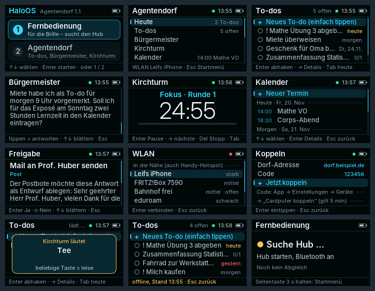
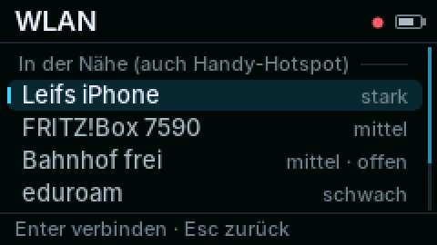
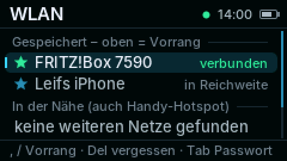
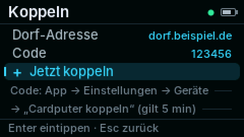

# Agentendorf auf dem Cardputer Adv – Firmware 1.1

Beim Einschalten zeigt der Cardputer ein Startmenü:

1. **Fernbedienung** – für die Brille, genau wie bisher (HaloOS 0.3): sucht den Hub per Bluetooth.
2. **Agentendorf** – dein Dorf in der Hosentasche, über WLAN: **Heute**, **To-dos**, **Bürgermeister**,
   **Kirchturm** (Pomodoro, Timer, Wecker), **Kalender**, **Freigaben**, **Fristen**, **Gewohnheiten**,
   **Notiz**, **Post**. Alles als Listen – das 3D-Dorf gibt es hier nicht.

**Neu in 1.1 – bekannte Netze:** Der Cardputer merkt sich bis zu acht WLANs (Heimnetz, Handy-Hotspot, …)
und verbindet sich von selbst mit dem, das gerade da ist. Die Reihenfolge in der Liste ist der Vorrang.
Er findet auch Netze, die in der Suche nicht auftauchen (iPhone-Hotspot, versteckte Netze), und wechselt
unterwegs vom Hotspot zurück ins Heimnetz, sobald es auftaucht.

Zwischen Fernbedienung und Agentendorf wechselst du über einen kurzen Neustart (etwa zwei Sekunden): in der
Fernbedienung die Seitentaste 3 s halten, im Agentendorf `Esc` auf der Startseite. Der zuletzt benutzte
Punkt ist beim nächsten Einschalten vorgewählt.



---

## Teil 1: Aufspielen (Windows-PC, PowerShell)

Du brauchst: den Cardputer, ein USB-C-**Daten**kabel und `agentendorf-cardputer-1.1.zip` im Ordner
„Downloads“. Python ist auf dem PC schon da. PowerShell öffnen (Windows-Taste, „PowerShell“ tippen, Enter).
**Jeden Block einzeln kopieren, einfügen, Enter.**

**1. Auspacken** – nach `Agentendorf-Cardputer` in deinem Benutzerordner:

```powershell
$zip = Get-ChildItem "$HOME\Downloads\agentendorf-cardputer-1.1*.zip" | Sort-Object LastWriteTime | Select-Object -Last 1; Unblock-File $zip.FullName; Expand-Archive -Force $zip.FullName "$HOME\Agentendorf-Cardputer"; cd "$HOME\Agentendorf-Cardputer"; dir
```

Du siehst: `ANLEITUNG.md`, `agentendorf-cardputer-1.1.bin`, `agentendorf-cardputer-1.1-nur-programm.bin`,
`SHA256.txt` und den Ordner `bilder`.

**2. Prüfsumme** – ist die Datei heil angekommen? Erwartet: `True`

```powershell
cd "$HOME\Agentendorf-Cardputer"; (Get-FileHash agentendorf-cardputer-1.1.bin -Algorithm SHA256).Hash.ToLower() -eq ((Get-Content SHA256.txt)[0] -split ' ')[0]
```

**3. Flash-Werkzeug einrichten** (einmalig, ca. 1 Minute; landet nur in diesem Ordner)

```powershell
cd "$HOME\Agentendorf-Cardputer"; if (Get-Command py -ErrorAction SilentlyContinue) { py -m venv .venv } else { python -m venv .venv }; .\.venv\Scripts\python.exe -m pip install --quiet esptool==4.8.1
```

**4. Cardputer anschließen** – per USB-C an den PC, einschalten. Verbindung prüfen:

```powershell
cd "$HOME\Agentendorf-Cardputer"; .\.venv\Scripts\python.exe -m esptool --chip esp32s3 flash_id
```

Erwartet: `Chip is ESP32-S3` und `Detected flash size: 8MB`.
Kommt `Failed to connect` oder findet er keinen Anschluss: **Download-Modus** – Cardputer ausschalten und
abziehen, die Taste **G0** gedrückt halten, wieder einstecken bzw. einschalten, Taste loslassen, Befehl
wiederholen. (Die genaue Lage von G0 steht in der Kurzanleitung von M5Stack.)

**5. Sicherung der jetzigen Software** – alles, was gerade auf dem Cardputer ist (z. B. HaloOS 0.3 samt
Einstellungen), 8 MB, dauert 1–3 Minuten. **Nicht überspringen** – damit kommst du immer zurück.

```powershell
cd "$HOME\Agentendorf-Cardputer"; .\.venv\Scripts\python.exe -m esptool --chip esp32s3 read_flash 0 0x800000 cardputer-sicherung-vor-agentendorf.bin
```

Prüfen – es muss genau `8388608` herauskommen:

```powershell
(Get-Item "$HOME\Agentendorf-Cardputer\cardputer-sicherung-vor-agentendorf.bin").Length
```

**6. Agentendorf aufspielen**

```powershell
cd "$HOME\Agentendorf-Cardputer"; .\.venv\Scripts\python.exe -m esptool --chip esp32s3 write_flash 0x0 agentendorf-cardputer-1.1.bin
```

Erwartet am Ende: `Hash of data verified.` und `Hard resetting`.

**7. Neustart.** Der Cardputer startet von selbst neu und zeigt das Startmenü, oben steht
„HaloOS · Agentendorf 1.1“. Bleibt der Bildschirm dunkel (nach Download-Modus von Hand): einmal aus- und
einschalten.

Was beim Aufspielen verloren geht: die im Cardputer gespeicherten **Einstellungen der Fernbedienung** (der Hub
hat eine Kopie und schickt sie beim ersten Verbinden zurück). Was bleibt: die Dateien im internen Speicher
bzw. auf der SD-Karte.

---

## Teil 2: Ersteinrichtung am Gerät

### WLAN

Im Startmenü `2` drücken. Beim ersten Mal erscheint die WLAN-Liste.



1. Netz mit `;` / `.` wählen, `Enter`.
2. Passwort eintippen, `Enter`. Unten steht „verbinde mit …“, dann „Verbunden ✓“. Das Netz ist gespeichert.

**Heimnetz und Hotspot – so richtest du mehrere Netze ein:**

- Erst das Netz verbinden, das gerade da ist (z. B. zu Hause das Heimnetz). Danach unter
  **Einstellungen → WLAN-Netze** das nächste hinzufügen: Hotspot am Handy einschalten, in der Liste wählen,
  Passwort tippen. Bis zu acht Netze.
- **iPhone-Hotspot:** In den iPhone-Einstellungen unter „Persönlicher Hotspot“ **„Kompatibilität maximieren“**
  einschalten (der Cardputer kann nur 2,4 GHz) und beim Einrichten diese Seite **offen lassen** – nur dann
  ist der Hotspot in der Liste sichtbar. Bei Android im Hotspot das 2,4-GHz-Band wählen.
- Taucht ein Netz nicht auf: „Neu suchen“ (unten in der Liste) oder **„Anderes Netz“** – dann tippst du den
  Namen von Hand (genau wie am Handy/Router, Groß-/Kleinschreibung zählt). So geht auch ein verstecktes Netz.
- Netze mit Anmeldeseite im Browser oder mit Benutzername (eduroam) gehen **nicht**.
- Im Passwortfeld ist `` ` `` ein normales Zeichen; abbrechen dort mit `fn` + `` ` `` (Esc).

**Was der Cardputer danach von selbst tut:**



- **Beim Start und wenn die Verbindung abreißt** sucht er und nimmt das gespeicherte Netz, das am weitesten
  **oben** steht (★ = gespeichert, grün = gerade verbunden). Der Vorrang zählt, nicht die Signalstärke – nur
  wenn das bevorzugte Netz kaum noch ankommt („sehr schwach“), nimmt er das nächste.
- **Vorrang ändern:** gespeichertes Netz wählen, `,` schiebt es nach oben, `/` nach unten. Sinnvoll: Heimnetz
  oben, Hotspot darunter. (`Del` = vergessen, `Tab` = Passwort neu eingeben, `Enter` = jetzt verbinden.)
- **Hotspot nicht in der Suche?** Sieht er keines seiner Netze, probiert er die gespeicherten der Reihe nach
  direkt durch – so findet er den iPhone-Hotspot auch, wenn dessen Seite nicht offen ist, und versteckte
  Netze. (Macht der iPhone-Hotspot gar nicht auf: am iPhone kurz die Hotspot-Seite öffnen.)
- **Unterwegs → zu Hause:** Hängt er am Hotspot und das Heimnetz (höherer Vorrang, guter Empfang) taucht auf,
  wechselt er innerhalb von etwa drei Minuten von selbst. Hast du ein Netz gerade von Hand gewählt, bleibt
  er dabei.
- **Kein bekanntes Netz da:** Er versucht es in immer größeren Abständen wieder (15 Sekunden bis 5 Minuten),
  damit der Akku hält. Sofort neu versuchen: Einstellungen → WLAN-Netze → „Neu suchen“.
- Mit welchem Netz er verbunden ist, steht unten auf der Startseite („WLAN …“) und unter Einstellungen.
  Der Punkt oben neben der Uhr: grün = verbunden, gelb = verbindet, rot = getrennt.

### Koppeln

Nach dem ersten WLAN erscheint „Koppeln“ (später: Einstellungen → Koppeln).



1. „Dorf-Adresse“ → `Enter` → **deine Dorf-Adresse** tippen (wie in der Adresszeile der App, ohne
   `https://`) → `Enter`. Das `https://` ergänzt der Cardputer; unverschlüsselt verbindet er sich nie.
2. In der Agentendorf-App am Handy oder PC: **Einstellungen → Geräte → „Cardputer koppeln“**. Die App zeigt
   einen **6-stelligen Code** (gilt 5 Minuten, nur einmal).
3. Am Cardputer „Code“ → `Enter` → die 6 Ziffern tippen → `Enter`.
4. „Jetzt koppeln“ → `Enter`. Es erscheint „Gekoppelt ✓“ und die Startseite.

„Code falsch oder abgelaufen“: in der App einen neuen Code holen. „Dorf nicht erreichbar“: Adresse prüfen
(und ob das WLAN ins Internet kommt).

Unter **Einstellungen** (letzter Punkt der Startseite) findest du später alles wieder: WLAN-Netze, neu koppeln,
Gerät entkoppeln, Warteschlange, Lautstärke, Version. Sperrst du den Cardputer in der App (Einstellungen →
Geräte), zeigt er „Neu koppeln“.

---

## Teil 3: Bedienung

| Taste | Wirkung |
|---|---|
| `;` `.` (Pfeile hoch/runter) | auswählen · in Texten blättern |
| Enter oder Leertaste | öffnen, abhaken, bestätigen |
| `/` (Pfeil rechts) | To-do: Details mit Teilschritten · Pomodoro: nächste Phase · Einstellungen: Wert + · WLAN: Vorrang tiefer |
| `,` (Pfeil links) | zurück · Einstellungen: Wert − · WLAN: Vorrang höher |
| `` ` `` (Esc) | zurück · auf der Agentendorf-Startseite: zum Startmenü (mit Rückfrage, Neustart) |
| del | löschen bzw. stoppen (mit Rückfrage) · im Textfeld: Zeichen löschen |
| tab | To-dos: zwischen „offen“ und „heute“ wechseln · Kirchturm: Menü · WLAN: Passwort neu |
| opt + a / o / u / s | ä ö ü ß (mit Shift: Ä Ö Ü) · opt + e = € |
| einfach lostippen | To-dos: neues To-do · Bürgermeister: neue Nachricht |
| irgendeine Taste, wenn der Kirchturm läutet | Klingeln quittieren |
| Seitentaste | Bildschirm wecken · im Fernbedienungs-Modus 3 s halten: Startmenü |

**To-dos.** Text tippen und `Enter` – das Dorf deutet ihn wie in der App: „Mathe Übung 3 morgen !“ wird
ein wichtiges To-do für morgen (`morgen`, `fr`, `24.12.`, `30 min`, `!`). `Enter` hakt ab, `/` zeigt die
Teilschritte (einzeln abhakbar), `del` löscht (Papierkorb im Dorf).

**Bürgermeister.** „Neues Gespräch“ oder einfach lostippen, `Enter` schickt ab. Oben steht „denkt …“, der
Cardputer fragt alle 3 Sekunden nach. Die Antwort erscheint umgebrochen, `;` / `.` blättern. Zum Antworten
wieder tippen. `Esc` verlässt das Gespräch – der Bürgermeister arbeitet weiter, das Gespräch steht in der Liste.

**Kirchturm.** `Enter` startet einen Pomodoro bzw. pausiert ihn, `/` springt zur nächsten Phase, `del` stoppt.
`t` = Timer (Minuten tippen, z. B. `10` oder `4 Tee`), `w` = Wecker (`730`, `7:30`), `e` = Pomodoro-Zeiten
und Lautstärke, `tab` = Menü mit allem. Laufen mehrere Uhren, wechseln `;` / `.` zwischen ihnen. Die Uhren
laufen im Dorf – am Handy gestartete erscheinen auch hier. Läutet es, piept der Cardputer, der Bildschirm
wird hell, eine beliebige Taste quittiert. Das klappt in jeder Ansicht des Agentendorfs (er sieht alle
30 Sekunden nach), nicht aber im Startmenü oder in der Fernbedienung.

**Kalender.** Die nächsten 14 Tage. „+ Neuer Termin“ → Titel → Tag (Pfeile: ±1 Tag / ±1 Woche, oder tippen:
`2412` = 24.12.) → Uhrzeit (`15`, `930`, `1530` oder `15:30`; leer = ganztägig). Mit Uhrzeit dauert der
Termin 60 Minuten. Er landet im Marktplatz-Kalender. Löschen und Ändern geht nur in der App.

**Freigaben.** `Enter` öffnet den Antrag, `;` / `.` blättern. `Enter` = Ja (mit Rückfrage), `n` oder `del` =
Nein – danach kannst du eine Begründung tippen (oder leer lassen).

**Heute, Fristen, Post** sind zum Lesen (`Enter` zeigt Details); in „Heute“ und „Gewohnheiten“ hakt `Enter` ab.
**Notiz**: tippen, `Enter` – landet in der Tagesnotiz.

**Ohne Netz.** Listen zeigen den letzten Stand, unten steht gelb „offline, Stand 14:03“. To-dos anlegen und
abhaken, Teilschritte, Gewohnheiten und Notizen merkt sich der Cardputer („… – wird nachgeschickt“) und
schickt sie, sobald das Dorf wieder erreichbar ist – auch nach dem Ausschalten. Doppelt ankommen kann nichts.
Alles andere (Bürgermeister, Freigaben, Termine, Kirchturm stellen, löschen) braucht Netz.

**Uhrzeit.** Kommt vom Dorf, sobald die Startseite geladen ist. **Bildschirm:** nach 30 s gedimmt, nach
2 Minuten aus; die erste Taste weckt nur. Das WLAN bleibt dabei an – für lange Akkulaufzeit ausschalten.

---

## Teil 4: Zurück und weiter

### Sicherung zurückspielen (falls etwas nicht stimmt)

Den Startlader im Chip (ROM) kann keine Firmware überschreiben: Der Download-Modus (Teil 1, Schritt 4) geht
**immer**. Mit der Sicherung aus Schritt 5 ist der Cardputer danach exakt wie vorher:

```powershell
cd "$HOME\Agentendorf-Cardputer"; .\.venv\Scripts\python.exe -m esptool --chip esp32s3 write_flash 0x0 cardputer-sicherung-vor-agentendorf.bin
```

Ohne Sicherung: HaloOS 0.3 genauso an `0x0` schreiben (Datei `haloos-cardputer-0.3.bin` in diesen Ordner
legen), oder die Werks-Software mit M5Burner bzw. dem „Cardputer-Adv Easyloader“ von M5Stack (Links auf
docs.m5stack.com).

```powershell
cd "$HOME\Agentendorf-Cardputer"; .\.venv\Scripts\python.exe -m esptool --chip esp32s3 write_flash 0x0 haloos-cardputer-0.3.bin
```

### Spätere Versionen aufspielen, ohne neu einzurichten

Das volle Abbild (Teil 1, Schritt 6) löscht auch die gespeicherten WLAN-Netze und die Kopplung. Ist schon
eine Agentendorf-Firmware auf dem Cardputer, reicht für eine neuere Fassung die **Nur-Programm-Datei** – WLAN,
Kopplung und Warteschlange bleiben. Neue ZIP wie in Schritt 1 auspacken, dann (Versionsnummer der neuen
Datei einsetzen):

```powershell
cd "$HOME\Agentendorf-Cardputer"; .\.venv\Scripts\python.exe -m esptool --chip esp32s3 write_flash 0x10000 agentendorf-cardputer-1.1-nur-programm.bin
```

Nur verwenden, wenn schon eine Agentendorf-Firmware drauf ist – sonst Schritt 6.

---

## Was geprüft ist – und was nicht

- **Geprüft (am PC, mit genau dem Code, der auf dem Cardputer läuft):** Startmenü, WLAN-Einrichtung, Koppeln,
  alle Ansichten und Abläufe oben, die Warteschlange ohne Netz (auch: Antwort geht verloren, es kommt trotzdem
  nur einmal an; Neustart dazwischen), „offline, Stand …“, das Läuten im Hintergrund, 401 → „Neu koppeln“.
  Neu in 1.1: falsches Passwort, verstecktes Netz wird ohne Suche gefunden, Vorrang bei mehreren Netzen, sehr
  schwaches Netz wird übergangen, Wechsel ins Heimnetz, keine Dauerschleife ohne Netz. 140 Prüfungen gegen
  einen nachgebauten Server und ein **nachgestelltes** WLAN. Die Bilder stammen aus diesem Test.
- **Übersetzt** mit der offiziellen ESP32-S3-Werkzeugkette (Arduino-Core 2.0.17), eigener Code ohne Warnungen;
  das Programm belegt 46 % des Platzes.
- **Noch nie auf einem echten Cardputer gelaufen.** Am PC nicht prüfbar und deshalb zuerst ansehen:
  - **WLAN am echten Funkchip:** Verbindet er sich mit Heimnetz und Hotspot? Findet er den iPhone-Hotspot
    ohne offene Hotspot-Seite (das hängt auch vom iPhone ab)? Klappt der Wechsel Hotspot → Heimnetz? Meldet
    er ein falsches Passwort zügig?
  - **HTTPS:** Klappt das Koppeln mit deinem Dorf? Die Zertifikatsprüfung kennt Let's Encrypt und ZeroSSL –
    stellt dein Dorf ein anderes Zertifikat aus, erscheint „Dorf nicht erreichbar“.
  - **Arbeitsspeicher:** WLAN und Verschlüsselung brauchen viel davon. Unter Einstellungen steht ganz unten
    „… KB RAM frei“ – sag mir die Zahl, wenn etwas hängt oder neu startet (z. B. bei sehr langen
    Bürgermeister-Antworten).
  - **Geschwindigkeit:** Die erste Anfrage nach dem Verbinden dauert ein paar Sekunden.
  - Wie schon bei HaloOS: opt-Umlaute, Lautsprecher-Lautstärke, SD-Karte, Farben.
- Die **Fernbedienung** ist unverändert übernommen, aber in dieser Firmware ebenfalls nicht am Gerät getestet.
- Ein versteckt sendendes Netz mit höherem Vorrang erkennt der automatische Wechsel nicht (er sieht es in
  der Suche nicht) – dann von Hand wählen oder kurz aus- und einschalten.
- Das Ablaufdatum von Zertifikaten prüft der Cardputer nicht (Einschränkung der verwendeten Bibliothek);
  Aussteller und Name werden geprüft.
- WLAN-Passwörter und der Geräteschlüssel liegen unverschlüsselt im Cardputer. Geht er verloren: in der App
  unter Einstellungen → Geräte sperren (und die WLAN-Passwörter ändern).
