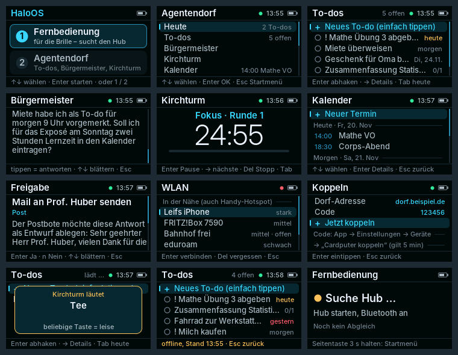

# Agentendorf auf dem Cardputer (Firmware 1.0)

Firmware für den **M5Stack Cardputer Adv** (ESP32-S3, 8 MB Flash, kein PSRAM, 240×135-Display).
Hervorgegangen aus „HaloOS 0.3“. Das Startmenü bietet:

1. **Fernbedienung** – unverändert aus HaloOS: Tasten, Akku und Bewegung per Bluetooth LE an den Hub der Brille.
2. **Agentendorf** – To-dos, Bürgermeister, Kirchturm, Kalender, Freigaben, Fristen, Gewohnheiten, Notiz, Post
   als Listen, über WLAN und HTTPS gegen `/api/geraet/*` (Vertrag: [API.md](API.md)).

Für Leif (aufspielen, einrichten, bedienen): **[ANLEITUNG.md](ANLEITUNG.md)**.



## Aufbau

```
src/main.cpp              Hardware: Display, Tastatur (TCA8418), Ton, SD/LittleFS, NVS, Bluetooth (NimBLE),
                          WLAN + HTTPS in einer eigenen FreeRTOS-Aufgabe (GeraetNetz)
src/zertifikate.h         Wurzelzertifikate für die TLS-Prüfung (tools/zertifikate.py)
src/core/                 alles ohne Hardware – läuft unverändert im PC-Test
  app.*                   App (Ansichten-Stapel, Toast, Helligkeit), Startmenü, Bild der Fernbedienung
  ui.h                    Bausteine: Liste, Texteingabe, Auswahl, Rückfrage, Datumswahl, Lesetext
  dorf.*                  Agentendorf-Klient: Einstellungen, WLAN-Automatik, Anfragen (eine nach der anderen),
                          Zwischenspeicher („offline, Stand 14:03“), Warteschlange mit X-Vorgang, Kirchturm-Wächter
  dorf_ansichten.cpp      alle Ansichten des Agentendorfs
  net.h                   Schnittstelle Net: WLAN (suchen/verbinden) und HTTP (start/poll)
  json.*                  kleiner JSON-Leser ohne eigenen Speicher (Verweise in den Antworttext) + JsonBau
  gfx.*, fonts*           Zeichnen in einen Bildspeicher, Inter-Schrift (aus HaloOS)
  remote_core.*           Fernbedienung (aus HaloOS, unverändert)
  cardo_data.*            Datum/Uhr + Cardo-Abgleich mit dem Hub im Fernbedienungs-Modus (aus HaloOS, unverändert)
include/haloos_protocol.h Bluetooth-Protokoll der Fernbedienung
host/dorf_host.cpp        dieselbe App als PC-Programm (Tasten über stdin, Netz über Sockets, WLAN nachgestellt)
host/fernbedienung_host.cpp  Simulator-Brücke der Fernbedienung (aus HaloOS)
test/                     testserver.py (bildet API.md nach), host_test.py, host-test.sh
tools/                    build.sh, werkzeug.sh, zertifikate.py, fontgen.py
fonts/                    Inter (SIL Open Font License 1.1, fonts/LICENSE-Inter.txt)
release/                  fertige Firmware + SHA256.txt
docs/bilder/              Bildschirmfotos aus dem PC-Test
```

## Entscheidungen

- **Moduswechsel = Neustart.** Im Startmenü läuft weder Bluetooth noch WLAN. „1“ startet NimBLE, „2“ startet
  WLAN – nie beides, damit der Speicher im Agentendorf ganz WLAN und TLS gehört. Zurück ins Menü geht nur
  über einen Neustart (Seitentaste 3 s in der Fernbedienung, Esc auf der Agentendorf-Startseite). Der zuletzt
  gewählte Modus steht als Merker im NVS (`dorf`/`modus`) und ist im Menü vorgewählt.
- **Cardo-Abgleich bleibt in der Fernbedienung drin.** HaloOS 0.3 gleicht im Fernbedienungs-Modus Cardo-Daten
  mit dem Hub ab. Der Code ist unverändert geblieben (der Cardputer speichert die Daten weiter in
  `/haloos/cardo.txt`, zeigt sie nur nicht mehr an). Entfernen hätte das Verhalten gegenüber dem Hub geändert,
  den ich hier nicht testen kann – drinlassen ist das kleinere Risiko. Einziger Unterschied: Die Datei wird
  erst beim Start der Fernbedienung geladen, nicht schon im Startmenü.
- **Netz in eigener Aufgabe.** Ein TLS-Handshake dauert auf dem ESP32-S3 1–3 s, bei schwachem Hotspot länger.
  Blockierend in `loop()` stünden so lange Tasten, Kirchturm-Uhr und Läuten. Deshalb bearbeitet eine
  FreeRTOS-Aufgabe (Kern 0) genau eine Anfrage; die Oberfläche fragt nur ab (`Net::poll`) und zeigt „lädt …“.
  Grenzen: Verbinden 6 s, TLS-Handshake 8 s, Lesen 8 s; der Kern gibt nach 30 s auf. Die Verbindung bleibt offen
  (keep-alive). Antworten über 48 KB werden abgelehnt.
- **TLS mit Prüfung.** `WiFiClientSecure::setCACert` mit ISRG Root X1/X2 und USERTrust RSA/ECC, Hostname wird
  geprüft, kein `setInsecure`. Einschränkung des Arduino-Cores 2.0.17: Sein mbedTLS ist ohne
  `MBEDTLS_HAVE_TIME_DATE` gebaut – das Ablaufdatum der Zertifikate wird nicht geprüft (Kette und Name schon).
- **Eigener JSON-Leser statt ArduinoJson.** Ein Baum würde eine 20-KB-Antwort im Speicher mehr als verdoppeln.
  `Json` zeigt nur in den Antworttext; die Ansichten kopieren, was sie anzeigen.
- **Offline.** To-do anlegen/abhaken, Teilschritt, Gewohnheit und Notiz gehen immer zuerst in die Warteschlange
  (`dorf-warten.txt`, SD-Karte oder LittleFS) und von dort mit fester `X-Vorgang`-Kennung zum Dorf – bei
  Funkloch wird mit derselben Kennung wiederholt, der Server führt nichts doppelt aus. 4xx-Antworten gelten als
  endgültig (Eintrag wird verworfen, Meldung am Bildschirm). Gelesene Listen liegen als `c-*.json` daneben und
  werden ohne Netz mit „offline, Stand 14:03“ gezeigt (geschrieben wird nur bei geändertem Inhalt).
- **Uhr.** Kommt aus `/api/geraet/start` (`zeit`, `offsetMin`) – bei jedem Abruf der Startseite (dort jede
  Minute). Kein NTP. Vor dem ersten Abruf steht keine Uhrzeit im Kopf.
- **Kirchturm.** Die Uhren laufen auf dem Server. Der Cardputer zählt lokal aus `endeMs`/`jetztMs` herunter,
  gleicht alle 30 s ab (15 s, solange die Kirchturm-Ansicht offen ist) – auch im Hintergrund aller anderen
  Ansichten – und läutet, wenn `klingelt` nicht leer ist: Ton alle 4 s (höchstens 2 min), Bildschirm hell,
  jede Taste schickt `leise`.

## Bauen

```bash
tools/werkzeug.sh ~/cardputer-werkzeug      # einmalig: arduino-cli, Core, Bibliotheken, esptool
W=~/cardputer-werkzeug
PATH="$W/venv/bin:$PATH" ARDUINO_CLI=$W/bin/arduino-cli ARDUINO_CONFIG=$W/arduino-cli.yaml tools/build.sh
```

Core `esp32:esp32@2.0.17`, Board „ESP32S3 Dev Module“ (8 MB, DIO, `default_8MB`, USB-CDC), Bibliotheken
M5Unified 0.2.29, M5GFX 0.2.36, NimBLE-Arduino 2.5.2 und M5Cardputer 1.2.0 (nur als Git-Tag erhältlich; die
`library.properties` darin nennt noch 1.1.1). Ergebnis: `release/agentendorf-cardputer-1.0.bin` (für `0x0`),
`…-nur-programm.bin` (für `0x10000`) und `SHA256.txt`. Bei gleichen Pfaden entsteht Bit für Bit dieselbe Datei.

Stand 1.0: Programm 1 544 601 Bytes (46 % von 3,3 MB), feste Variablen 122 912 Bytes (davon 64 800 der
Bildspeicher). Eigener Code ohne Warnungen (`--warnings all`, Warnung = Abbruch); die sechs Warnungen im
Protokoll stammen aus NimBLE-Arduino selbst (`BLE_HS_HCI_ERR`, wie schon bei HaloOS).

## Tests

```bash
test/host-test.sh      # braucht nur g++ und python3
```

Übersetzt `core/` für den PC (`-Wall -Wextra -Werror`), startet den Testserver und spielt die App per
Tastendruck durch: Startmenü, WLAN einrichten (falsches/richtiges Passwort), koppeln (falscher/richtiger Code),
Startseite, To-dos (anlegen, abhaken, Teilschritt, löschen, heute), Bürgermeister (Polling bis „fertig“,
Weiterreden), Kirchturm (Pomodoro, Pause, nächste Phase, Einstellungen, Wecker, Timer, Läuten im Hintergrund,
Quittieren), Kalender, Freigaben (Ja/Nein mit Begründung), Heute, Fristen, Gewohnheiten, Post, Notiz, Offline
(letzter Stand, Warteschlange, Funkloch mit verlorener Antwort → genau einmal), Neustart mit automatischem
WLAN, 401 → neu koppeln, entkoppeln. Die Bildschirmfotos in `docs/bilder/` stammen aus diesem Lauf.

Von Hand ausprobieren: `python3 test/testserver.py 8123`, dann `build/dorf-host` starten und Befehle tippen
(Kopf von `host/dorf_host.cpp`).

## Speicher im Gerät

| Wo | Was |
|---|---|
| NVS `dorf` | `wlan` (bis zu 8 Netze mit Passwort), `adresse`, `token`, `laut`, `modus` – unverschlüsselt |
| NVS `haloos` | `fb` – Einstellungen der Fernbedienung (wie HaloOS 0.3) |
| `/haloos/` auf SD-Karte, sonst LittleFS | `dorf-warten.txt` (Warteschlange), `c-*.json` (letzter Stand), `cardo.txt` (Hub-Abgleich) |

## Nicht enthalten

- `platformio.ini` aus HaloOS: war dort schon ungetestet und ist hier nicht nachgezogen.
- `InterDisplay-Light.otf` (große Ziffern): lag dem HaloOS-Paket nicht bei; `fonts_data.cpp` ist unverändert
  übernommen, `tools/fontgen.py` sagt, was zum Neu-Erzeugen fehlt.
